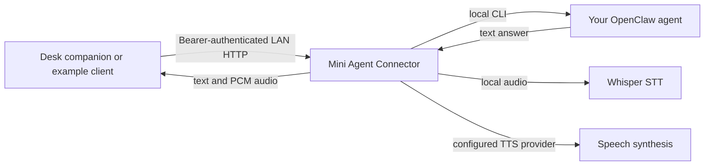

# Mini Agent Connector

A small, self-hosted bridge between a desk companion and an **OpenClaw agent**.
Extracted from the connector used by Mini Gero. Send a text question or a
push-to-talk recording, poll for the answer, and optionally stream speech back
to your device. Agent tools and memory stay on the host.

## Mini Gero in action

Mini Gero is one example of a desk companion powered by this connector.
These are actual **avatar framebuffer captures** from the ESP32-C6 device
(v0.13), showing four expression poses—not mockups or photos of the physical screen.

| Idle | Listening | Thinking | Speaking |
| :---: | :---: | :---: | :---: |
|  |  |  |  |

The device firmware renders and animates the avatar; the connector handles
requests, agent responses, and audio. These screenshots are included as examples;
the firmware and complete animation asset pack are not bundled.

## How it connects



## What is included

- Standard-library Python HTTP server; no web framework or gateway credentials on the device.
- Asynchronous jobs, bounded queue, quiet mode, activity badges, and timing metadata.
- Local speech recognition: persistent whisper.cpp / Metal on Apple Silicon, or Python Whisper.
- Configurable agent, conversation, model override, voice provider, and executables.
- Example client, dependency check, automated tests, CI, protocol and security documentation.

**Scope:** this repository is the **host connector**, not the Mini Gero display
firmware, complete avatar asset pack, board drivers, or a flash backup. Use the included client
without hardware, or implement [protocol v1](docs/PROTOCOL.md) in your own firmware.
Existing Mini Gero firmware remains wire-compatible; legacy service/header and
activity names are retained deliberately. No personal memory or device settings
are included.

## Requirements

- Python **3.10+**, macOS or Linux. Apple Silicon macOS is the primary voice target;
  Linux/PyTorch is supported in code but not hardware-verified. Windows is not supported.
- A working [OpenClaw](https://docs.openclaw.ai/) installation, configured agent,
  running gateway, and provider access. The bridge does not install or authenticate OpenClaw.
- CLI capabilities `agent --session-key --message-file --json` and optional
  `infer tts convert`. Extraction verified with OpenClaw **2026.9.8**;
  check your version's help if those commands differ.
- Optional speech output: `ffmpeg` and an OpenClaw-configured TTS provider.
- Optional speech input: one of the local Whisper engines below.

## Quick start — text first

From your checkout:

```sh
./scripts/setup.sh
.venv/bin/python server.py --config config.json --doctor
.venv/bin/python server.py --config config.json
```

The setup script creates a virtual environment and an ignored `config.json`.
It installs no global packages and starts no background services. The bridge
listens on **127.0.0.1:8765** by default. First start generates a separate random
bearer in `.runtime/device-token` (0600); runtime directory permissions are 0700.
Do not use an OpenClaw gateway token as the device token.

In another terminal, from the same checkout:

```sh
.venv/bin/python examples/client.py --health
.venv/bin/python examples/client.py --text 'What is two plus two? Do not use tools.'
```

The client reads the token from disk without printing it. Text tests use your
configured agent/provider and may incur provider charges. They default to quiet
mode. Unit tests never call a real provider.

## Configuration

Edit `config.json`; it is loaded **only** when passed with `--config`. Paths for
executables should be absolute or command names on `PATH`; `whisper_model` accepts
`~` or a path relative to the launch working directory. Use absolute paths for services.

| Setting | Default | Meaning |
| --- | --- | --- |
| `agent` | `main` | Existing OpenClaw agent ID |
| `session_key` | `mini-agent` | Dedicated persistent conversation; use a distinct key per connector |
| `model`, `thinking` | empty | Inherit configured agent; optional supported per-request overrides |
| `stt_engine` | `none` | `none`, `metal`, or `pytorch` |
| `whisper_model` | empty | Metal GGML model; empty uses runtime's `ggml-small.bin` |
| `whisper_server` | `whisper-server` | whisper.cpp server executable |
| `whisper_python` | current Python | Python interpreter with `openai-whisper` installed |
| `tts_provider`, `tts_voice` | empty | Use OpenClaw defaults; optionally override provider/voice |
| `openclaw`, `ffmpeg` | command names | Executable names or absolute paths |

Credentials remain in your own OpenClaw configuration. This connector neither
copies nor exports them. Its prompt uses your existing agent identity and asks
for permitted memory recall; a shared agent does **not** automatically merge all
chat histories. Use a dedicated low-privilege agent when other people can use
the device. See [security and retention](SECURITY.md).

## Enable speech output

Install `ffmpeg` (on macOS: `brew install ffmpeg`) and configure a TTS provider in
OpenClaw. Set `tts_provider` and `tts_voice` if needed, then restart the connector:

```sh
.venv/bin/python examples/client.py --speak --output .runtime/reply.pcm
ffplay -f s16le -ar 16000 -ac 1 .runtime/reply.pcm
```

Synthesis may send answer text to your configured cloud provider. The raw output
is signed PCM16 little-endian, mono, 16 kHz. A speech failure still returns the
text answer with `audio_error`; the example client exits nonzero if speech was requested.

## Enable local speech input

### Apple Silicon: whisper.cpp / Metal

```sh
brew install whisper.cpp ffmpeg
mkdir -p .runtime
chmod 700 .runtime
curl -fL --retry 2 \
  https://huggingface.co/ggerganov/whisper.cpp/resolve/main/ggml-small.bin \
  -o .runtime/ggml-small.bin
```

This downloads model weights, not code from this repository. See upstream model
licensing and provenance in [THIRD_PARTY.md](THIRD_PARTY.md). Set `stt_engine` to
`metal` in `config.json`. The default expects the multilingual **Small** GGML
model; tested upstream server version is **1.9.5**. Homebrew may install a newer
version: check `whisper-server --help` if startup fails. Metal requires Apple
Silicon support; the `metal` engine label does not detect or prove GPU use on
other platforms. Recognition is English, beam size 5 / best-of 5.

### Python Whisper alternative

```sh
.venv/bin/python -m pip install openai-whisper
```

Set `stt_engine` to `pytorch` and run the bridge with `.venv/bin/python` (or set
`whisper_python` to an absolute interpreter path). `ffmpeg` is also required.
First startup downloads Whisper Small if not cached; this can exceed the 120s
worker startup limit on a slow connection. Pre-cache it before launching:

```sh
.venv/bin/python -c 'import whisper; whisper.load_model("small")'
```

Restart after changing settings. Run `--doctor` to check dependencies. Warmup
failure leaves text working and voice retries worker startup on the next request.
Transcription is local; its resulting text is sent to your agent/model provider.

To test a recording you choose (no microphone is automatically opened):

```sh
ffmpeg -i your-recording.wav -t 12 -ar 16000 -ac 1 -f s16le .runtime/input.pcm
.venv/bin/python examples/client.py --pcm .runtime/input.pcm --speak
```

## Connect a device

1. Run the connector with `--host YOUR_PRIVATE_LAN_IPV4` (and `--config config.json`).
   Wildcard/public addresses are rejected. Reserve the host's DHCP address.
2. Configure your firmware with that HTTP base URL, port 8765, and the locally
   generated **device** token. Read/copy it locally without committing it or
   putting it in a URL. Never reuse the live device's token for a new installation.
3. Implement the [protocol](docs/PROTOCOL.md): submit once, poll until terminal,
   then stream returned PCM. Use explicit push-to-talk, not ambient capture.
4. Verify Wi-Fi, physical microphone, speaker, and display separately.

Plain HTTP is **trusted-LAN only**. Do not expose the port to the Internet or
port-forward it. Bearer authentication does not encrypt traffic. This is a small
single-owner bridge, not a hardened public or multi-user service.

## Develop and publish

```sh
python3 -m unittest discover -v
python3 scripts/audit_release.py
```

See [CONTRIBUTING.md](CONTRIBUTING.md) for checks and [PUBLISHING.md](docs/PUBLISHING.md)
for manual GitHub push instructions. MIT licensed. Third-party programs/models
are separate dependencies and are not bundled.
